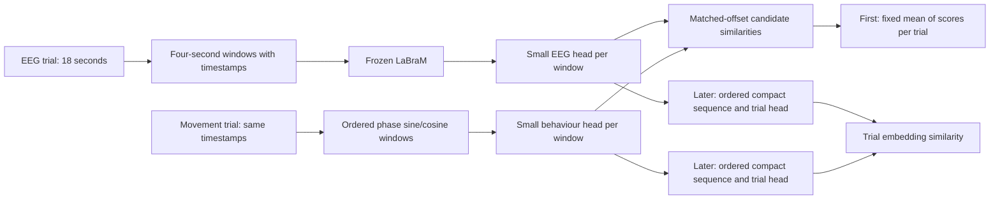

# First-draft implementation plan

**Current implementation:** preparation metadata verified; repetition splits and combined-closed/self galleries
are implemented. The user-selected first task combines closed1 and closed2; open-first proposals below are
superseded. Up to 40 trials per person inherit 12/4/4 paired repetitions (24/8/8 trials before exclusions).
Separate-closed and open profiles preserve the same assignments.
See README.md for the authoritative current contract and cluster command. The original cohort manifest is
required; seed 2042 assigns 12/4/4 repetitions before artifact filtering, with variable candidate counts.
Model stages below remain proposals.

**Implementation correction (11 November 2026):** the user has designated the colleague's original mTRF
notebook as the artifact-exclusion authority. New preparation uses its exact mapping and membership test,
not the contrastive reader's `index // 3` assumption. Earlier discussion below of separate exclusion profiles
is superseded for this project's preparation. See README.md for format version 2 and rerun instructions.

**Design draft: 10 November 2026. Preparation implemented 11 November; see README.md for current commands.**

The preparation choices below are superseded by the user-approved whole-trial rejection and eight overlapping
windows per retained trial documented in README.md. Training and evaluation sections remain proposals.

This plan follows the [research report](RESEARCH.md). Its first deliverable is a verified EEG–movement manifest,
not a large model. Each stage should produce a reviewable artifact and answer a specific question before adding
complexity. Existing `labram_classification`, `hyperscanning_contrastive` and `mTRF` remain independently reproducible.

## 1. Lock the task vocabulary and comparison profiles

The query is one participant's EEG. Candidates are movement records from that same participant/condition, with
roles defined relative to the query participant. Distinguish `self`, `full` and `partner` targets. The Full target
has exactly the five mTRF predictors; Self and Partner use two sine/cosine channels each.

Keep two named profiles:

| Profile | Contract | Use |
|---|---|---|
| `mtrf-compatible` | Original corrected trial identities, historical exclusions, saved outer-fold candidates, Full target, 18-second interval | Exact retrospective comparison with the existing mTRF result |
| `clean-window` | Audited six-second artifact intervals, explicit clean support and a new whole-trial development split | Scientific development with trusted clean observations |

Do not claim that results from the two profiles are directly comparable. If CL scores only clean subsets of an
18-second trial, label it a limited-support comparison and score/refit an mTRF comparator on the matched protocol.
A historical whole-trial score is still useful context but is not the same measurement.

**Provisional first target:** Self in `open`, then Full on the same protocol. Self is an engineering/feasibility
step; Full is required before comparing with the existing approximately 50% user-reported result. Partner-only
retrieval and claims about social information come later.

## 2. Stage 0 — audit alignment and preserve evaluation identity

Inputs are the local preprocessed Circling FIFs, the trusted six-second artifact dictionary, the verified vertical
`phase_list.pickle`, and, when available, completed mTRF/retrieval artifacts. Reuse movement extraction if the phase
file must be regenerated; do not invent a new phase convention in this package.

Produce an audit with one row per original dyad/repetition/condition and participant, containing:

- Raw source paths and hashes; source EEG epoch/event IDs; original and corrected movement trial IDs.
- Absolute condition timing, crop-relative timing, sample rates and half-open sample boundaries.
- Pair 2030 practice handling, pair 2450 correction and pair 2020 onset-provenance status.
- Historical mTRF keep/drop, six-second bad intervals, and clean four-second offsets, with exclusion reasons.
- Separate experiment-repetition ID spanning Before/Vision/After, so future condition extensions cannot leak
  adjacent parts of the same repetition across splits.
- Existing cohort reservation, new split assignment and prior-exposure status.

Validate all 52 dyads structurally. The main comparison omits pair 2020 consistently with mTRF group aggregation;
retain its audit/detail records. Do not select participants for their neural decoding accuracy.

Compare policies and report retained trials/windows by dyad, participant and condition, disagreement counts,
usable gallery sizes and expected chance. Verify that experimental repetitions can actually be joined across
conditions; fail explicitly if event metadata cannot establish that relation. Read-only metadata auditing may
inspect reserved file headers, but reserved EEG must not be forwarded or used to fit any statistic.

For the first feature check, use a predeclared small set of development trials. Plot EEG/movement timing, phase
components and exclusion masks. Reconstruct at least one original mTRF fold's gallery and baseline diagonal when
the authoritative run becomes available. Report missing artifacts as unresolved inputs, not inferred results.

**Gate:** exact identities, timing, units and exclusions are demonstrably correct; both participant views stay
together; no trial crosses splits. Stop model work on an alignment discrepancy.

## 3. Split policy before feature extraction

Use the existing contrastive cohort manifest as the starting reservation if available: its fold 1 is external
validation and fold 2 is test. Verify its hashes and the exposure ledger before claiming either is untouched.
The initial project uses only the original training dyads. Do not recreate a nominally identical fold assignment
from current file ordering.

Within those development dyads, assign paired **whole experimental repetitions** to train, validation and a locked
within-dyad test. Aim for approximately 60/20/20: 12/4/4 when all 20 repetitions are usable. The exact integer rule
must be chosen from the audit, saved and applied identically to all arms. Do not drop sparse dyads based on accuracy.
The first four-way validation benchmark requires four eligible trials; otherwise report a smaller gallery and its
chance or a prespecified eligibility exclusion. Record the denominator either way.

Use seed 2042 provisionally, preserving source identities, and maintain a chronological held-trial sensitivity
split later to detect drift/order shortcuts. All conditions of the same repetition inherit its assignment, even
when the first run selects only open. Windows, shifts, augmentations, both people and every target variant inherit
that assignment. Fit means, scales and any dimensional reduction on training rows only.

The legacy mTRF benchmark follows its **saved** outer folds instead. For each outer evaluation, all held-out
candidate EEG and behaviour are excluded from CL training, including the partner view. CL validation comes only
from that outer training partition. A shared model may train on other participants, so report this training-data
advantage over individual mTRFs and add a person-specific small-head comparator where feasible. If using multiple
conditions makes the saved folds inconsistent at repetition level, restrict the comparison to open or define a new
paired protocol; do not silently allow that leakage.

Historical mTRF test summaries already influenced design. Its reused benchmark is **retrospective**. A final
claim needs settings locked before evaluation on data not used for project decisions; if no such data remain,
describe the comparison as exploratory and plan external/new-session validation.

## 4. Stage 1 — synthetic and tiny-set controls

Before interpreting EEG results, verify a synthetic paired dataset with known phase, lag, subject offsets and
trial identity. Include wrap crossings, resampling, overlapping windows, missing intervals, tied similarities and
shuffled correspondence. The small model should recover deliberately injected cross-modal signal, while a
held-out independently paired control should behave at chance over repeated simulations.

For real data, fit 8–16 training-only distinct trials from a deterministic development selection. Test pooled and
temporal readouts and an intentionally sufficient tiny diagnostic head. Near-perfect training retrieval is an
engineering target, not a generalization result. A fixed shuffled arm may also memorize; that is expected.

**Gate:** finite gradients and updates, correct targets/masks, strong synthetic recovery, correct tie-aware chance,
and tiny-set fit. Failure prompts checks of timing, features, normalization and optimization before scaling.

## 5. Stage 2 — the first real-data experiment

Use one shared model across development people with **within-person candidate sets**. A candidate set contains
distinct trials of one person, condition and relative four-second interval. Compute separate losses per set and
average four sets per update. No cross-person or cross-condition negatives in the first experiment.

| Setting | Provisional default / bounded comparison |
|---|---|
| Condition and target | `open`, Self; then Full as a separate run |
| EEG | Original pretrained LaBraM, frozen and in evaluation mode; canonical 64 channels, 200 Hz, µV/100 |
| Training windows | Fixed non-overlapping starts 0,4,8,12 seconds relative to the cropped trial; eligible clean windows only |
| EEG readout | Pooled versus four ordered temporal tokens |
| Movement | Sine/cosine derived from the verified phase, anti-aliased to provisional 50 Hz, retaining time order |
| Heads | Separate bias-free linear projections to 64 dimensions; final L2 normalization |
| Centering | Global training mean versus participant training mean; uncentered diagnostic retained |
| Loss | Symmetric masked InfoNCE, initial temperature 0.1 |
| Optimizer | AdamW, initial head LR 0.001, weight decay 0.01; finite-gradient checks and clipping at 5 |
| Duration | Initial 20-epoch budget, best validation checkpoint including epoch zero; inspect convergence before extending |
| Checkpoint metric | Dyad-macro EEG→behaviour validation MRR, fixed galleries; ties select the earlier epoch |
| Controls | Matched true and fixed shuffled-training-trial arms |
| Replication | One seed for engineering, then three prespecified seeds for the chosen small comparisons |

These are starting settings grounded in local infrastructure, not literature-proven optima. If a correctly working
model underfits, tune only temperature `{0.05,0.1,0.2}` or LR `{0.0003,0.001}` first, one axis at a time. Record all
runs and keep update budgets comparable. Do not change data, target, head, loss and optimization simultaneously.

Use all eligible training trials at a given offset as candidates where practical. Report their distribution and
the true negatives per query separately from “four sets per update.” Normalize training contributions so a person
with more clean windows does not dominate accidentally. Serialize deterministic schedules and whole-trial shuffled
mappings. The shuffled mapping must remain valid at every used offset; construct sets on common eligible trials
or explicitly restrict to support on which the complete permutation is valid.

Fit a ridge EEG-feature→movement predictor on the same training data, choose regularization on validation, and
rank candidates by a fixed movement-space error/cosine rule. Report regression quality as well as retrieval.
For the learned CL model, cache and score validation candidates without fitting on them.

**Gate:** correct-pair training improves held-out retrieval over chance and matched shuffled training, across
seeds and dyads, with stable geometry. Examine paired dyad differences and uncertainty before advancing; do not
declare success from one best seed or a falling training loss. If uncertainty is too wide, collect more evidence
at this stage rather than raising task difficulty.

## 6. Stage 3 — find the representation bottleneck

Keep the successful target/splits/galleries fixed. Add a compact structured full-token head, using the local
shared-token/channel-mixture design as inspiration. Save parameter counts and both pre/post-normalization geometry.
Compare to pooled/temporal heads at a similar budget, plus a strongly regularized full-flat linear reference if
memory and training size make it reasonable. The full-flat result is a capacity ablation, not the default model.

Then compare the preferred phase-linear behaviour head with a small 1D CNN retaining temporal bins. Add
random-initialized frozen LaBraM with the same architecture and no checkpoint access. Use simple EEG spectral
features and a compact raw-EEG temporal model to diagnose whether frozen LaBraM is limiting the task. Do not infer
that zero-lag band power should reproduce phase; that comparator tests a different available cue.

Only after inspecting these outcomes consider partial LaBraM adaptation (last two blocks/pooling normalization;
encoder LR initially 1e-5, head LR initially 1e-3) or a training-only soft-target objective. Unfreezing invalidates
the frozen feature cache and requires separate provenance and compute. If both classical and neural approaches
fail on the new protocol, return to alignment/target identifiability rather than escalating model size.

**Gate:** a specific ablation supplies a repeatable validation gain or identifies the failing component. Stop
adding capacity when gains are absent; a useful negative result is an acceptable stage outcome.

## 7. Stage 4 — whole-trial retrieval, including the eight-window proposal

The trial remains the unit throughout; only how it is represented changes.

1. Evaluate the four-window model by averaging matching-offset candidate scores. Explicitly label the 16-second
   support rather than presenting it as complete 18-second coverage.
2. Extract the eight overlapping windows at cropped starts `0,2,4,6,8,10,12,14`, covering `[0,18)`. Score by an
   initially fixed equal-window mean, with identical candidate support. This adds context without trainable
   aggregation parameters.
3. Concatenate eight compressed vectors in order, with separate EEG and behaviour trial heads. Compare a small
   temporal CNN only if ordered concatenation has a clear limitation.
4. Optionally combine local and trial-level losses after the two separate stages work.

Use complete-window trials for the first learned trial model, and report the lost coverage. If this removes too
many trials, design a masked extension explicitly: timestamps and masks remain available to aggregation, but all
candidates in each gallery must use the same allowed offsets. Do not let matching missingness reveal the positive.
Do not stitch clean sections into a fake contiguous sequence. Score each trial equally regardless of its window count.

On a fixed common subset, compare four-window mean, eight-window mean, eight-window ordered concatenation and
the original mTRF Full scorer. This distinguishes extra support from learned long-range structure. A matched
time-order ablation checks whether ordering adds information. Overlap is never counted as independent sample size.

For the historical comparison, restore original outer-fold galleries and aggregate the new model's EEG scores
against the same whole movement records. Export per-query score matrices and paired differences. Retain K=3
galleries; do not discard them to force a constant 25% chance. If reproducing all five folds, refit all learned
transforms/heads inside each fold. Keep a protocol field recording that mTRF and CL use different preprocessing
and model-sharing regimes even when candidates and trial identities are identical.

**Gate:** trial-level retrieval provides a reproducible advantage over its local baseline at matched support, or
the simple score aggregate is retained. A long sequence model is not required if aggregation is sufficient.

## 8. Stage 5 — increase scientific difficulty one axis at a time

| Next experiment | What changes | What remains controlled |
|---|---|---|
| Full → Partner | Remove self/coordination channels from the candidate | Person, condition, timing, galleries and split |
| Open → closed conditions | Visual interaction context | Within-condition candidates; no pooled easy condition negatives |
| Random held trials → chronological held trials | Susceptibility to recording drift/order | Known people and target definition |
| Ordinary → speed/similarity-matched candidates | How specifically the model identifies a trajectory | Prespecified gallery construction; report both ordinary and difficult galleries |
| Familiar → unseen dyads | Population transfer | Locked architecture, global training centering; both members held out |
| Uncalibrated → calibrated unseen dyads | Allow a fixed calibration budget | Calibration trials disjoint from evaluation; report unlabeled vs paired-labelled use separately |

Use external-validation dyads to choose any transfer-specific policy. Keep final-test dyads out of this process.
Participant means on new dyads require calibration; a person-specific head additionally requires supervision or a
separately defined unsupervised adaptation objective. Neither is zero-calibration transfer.

For partner-specific interpretation, compare a self-movement-only predictor and quantify how much partner
retrieval can be explained by self/partner coordination. More precise incremental-information tests can follow;
they should not be conflated with the initial retrieval objective. Cross-dataset work on Mirror Game or Force
Game starts only after within-Circling success and participant-overlap checks.

## 9. Proposed package boundaries and outputs

Keep new orchestration and data contracts in `src/cl_behaviour`. Reuse narrow, tested utilities through explicit
adapters; do not import an adjacent experiment's entire runner. Do not change historical behavior as part of this
project. If a low-level utility must later be extracted, protect both consumers with regression checks.

| Proposed module | Responsibility / useful existing reference |
|---|---|
| `data.py`, `audit.py` | EEG–phase identity/timing manifests; `mTRF.movement`, `mTRF.eeg`, contrastive interval planner |
| `splits.py`, `galleries.py` | Repetition-grouped splits, historical gallery import, exposure/reservation checks |
| `features.py` | Frozen original LaBraM adapter and token reconstruction check |
| `behaviour.py` | Role-aware phase targets, anti-aliased resampling and target diagnostics |
| `normalization.py` | Training-only global/person statistics and calibration policy |
| `models.py`, `losses.py` | Separate branches, small ordered readouts and masked losses |
| `training.py`, `controls.py` | Matched schedules/initializations, synthetic controls, validation selection |
| `evaluation.py`, `baselines.py` | Directional tie-aware metrics, regression and mTRF comparisons |
| `plotting.py`, `__main__.py` | Reports/CLI after underlying contracts are tested |

Potential future CLI operations are `audit`, `prepare`, `controls`, `features`, `train`, `evaluate`, and
`compare-mtrf`. They are **not executable commands yet**. Add actual commands to the root `AGENTS.md` only when
implemented. Follow the repository's Python/pip, pytest, Ruff, typing and Google-docstring conventions.

Each completed run should contain:

- Immutable input/configuration/code/checkpoint hashes and package versions.
- `trials.csv`, `windows.csv`, `splits.csv`, `galleries.csv`, exclusion/coverage tables and target specification.
- Fitted normalization statistics, shuffled mappings, schedules, initial/best/last heads and selection reasons.
- Directional train/validation histories, geometry and gradient/update diagnostics, parameter counts and compute.
- Per-query candidate scores, participant/dyad summaries, chance values and plots.
- A completion marker written only after all required outputs pass validation. New runs use new directories.

Use CPU for metadata/phase preparation and cached-head training where feasible; GPU mainly for LaBraM extraction
and eventual adaptation. Profile a small extraction before setting HPC resources. Float32 full-token storage is
204,800 bytes per window; eight windows require about 1.64 MB per participant-trial before metadata. For all
52×2×20 open participant-trials, that is about 3.41 GB before exclusions and reservations. This is an upper-bound
planning calculation, not a measured cache size. Save pre-normalization tokens once and derive readouts in chunks.

## 10. Required validation and the first implementation slice

Meaningful future tests belong in `tests/cl_behaviour/`:

- Pair-specific trial corrections, six-second overlap boundaries and exact source-ID preservation.
- No shared experimental repetition or partner view across splits; reserved EEG access fails explicitly.
- Known synthetic phase/lag survives crop/resampling, including ±π crossings and endpoint conventions.
- LaBraM units applied once, canonical channel order, token shape/order and pooled reconstruction.
- Altering validation/test values cannot change fitted means/scales/PCA or training-target statistics.
- Same-trial/overlapping negatives prohibited; whole-trial shuffled mappings remain coherent across windows.
- Tied scores give the expected uniform-rank top-1 and MRR, including constant embeddings and K=3/4.
- Changing candidate order cannot change metrics; missingness cannot identify the positive.
- Historical gallery import and reference diagonal reproduce saved mTRF retrieval.
- Checkpoint selection never reads test metrics; random initialization never opens/hashes pretrained weights.

The first coding increment should deliver **Stage 0 plus synthetic controls and a tiny frozen-feature smoke run**.
Its review should show actual counts, timing/exclusion discrepancies, the proposed split, a few aligned traces,
token reconstruction and synthetic/tiny-fit outcomes. Only then launch Stage 2's small real-data comparison.

Before that increment, the unresolved inputs are the authoritative baseline-run path, phase-file path,
available final-evaluation cohort, and approval of the new-project artifact policy after the audit. The draft
assumes Self→Full→Partner and calibrated known-person development; these are proposed decisions for discussion.

## Feature-stage implementation update

Frozen full-token and 50 Hz sin/cos extraction is implemented; see README for the current smoke/full workflow.
No fitting, centering or loss is included. The user-approved later soft-target inspiration is
[arXiv:2610.09287](https://arxiv.org/html/2610.09287v1), whose frozen-teacher similarities should be distinguished
from a purely temporal weighting rule. Compare these explicitly during training rather than changing this cache.

## Synthetic-control implementation update

Self-contained loss, metrics, linear heads and CPU synthetic runner are implemented in `cl_behaviour`.
The default three-seed run passed known-correspondence generalization and independent held-out pairing nulls.
No real-data model was fitted. The next increment is the real training-only tiny-fit check; soft targets and
full real-data training remain later work. See README for exact synthetic protocol and reproduction command.

## Real tiny-fit implementation update

The training-only `tiny-fit` command now selects eight real trials from one development participant and a single
window offset. It compares pooled, temporal and full readouts with matched true/shuffled linear heads, using
selected-training-only centering and scalar normalization. No validation/test feature slices are fitted or scored.
See README for the CPU job and pass criteria. Real-data results are pending; generalization training remains next.

## First held-trial implementation

Within-person held-trial training is implemented; the README's exact contract supersedes the earlier tentative
64-dimensional head and optimization settings. Fresh 32-dimensional heads preserve the successful tiny-fit
architecture, with LR .001/decay .01 for generalization. Pooled/temporal/full readouts run matched true/shuffled
arms; participant means/scales use only training windows at offsets 0/4/8/12. Epoch-zero-inclusive validation MRR
selects checkpoints. PNG-only curves refresh each epoch. No test evaluation, soft-target loss, ridge comparator
or whole-trial aggregation is implemented in this increment. Those remain explicit subsequent comparisons.
