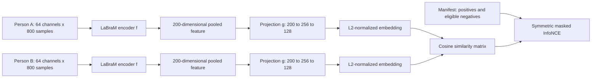

**Project 2: contrastive learning for partner-EEG retrieval**

Discussion draft, updated 19 October 2026. Stage 0 audit/cache tools, Stage 1 diagnostics, and the Stage 2 single-person SSL pilot are implemented.
Partner training and full cross-validation remain unimplemented. Proposed training settings below are starting hypotheses, not established optimal parameters.

Confirmed with the user: use the **local Circling dataset used for Project 1**, not the public release. Its artifact
dictionary indexes **six-second sections** after the two-second crop and practice removal. These local conventions
are authoritative. Public-release metadata below are background only. See README.md for the implemented data contract.

**1. Recommended direction and scientific question.**

Start with Circling, use a shared LaBraM encoder with a small projection head, and learn to match simultaneously
recorded EEG windows across partners. Make retrieval of the correct trial from the **same partner's other trials**
the primary task. Compare interactive and non-interactive conditions using the same trained model, candidate rules,
and held-out dyads. Use Force Game as a complementary replication with explicit feedback and group-size controls;
use Mirror Game as a later extension once its pairing metadata are established.

Here, retrieval means identifying an existing recorded partner segment among candidates. It does not mean generating
the partner's waveform. Waveform reconstruction would require a different objective and is particularly difficult
because only part of each person's neural activity is shared.

The central question is:

> Does one person's EEG contain information that identifies their partner's concurrent trial in previously unseen
> dyads, and is that information stronger during interaction after controlling for condition, timing, and identity?

Separate three claims:

- **Technical feasibility:** a contrastive EEG pipeline learns useful representations and retrieves paired signals.
- **Interaction-related information:** retrieval exceeds appropriate nulls and is stronger during interaction.
- **Incremental neural information:** EEG contributes predictive information beyond measured behavior and shared cues.

The third claim is a possible later extension. The user's proposed interpretation explicitly includes behavioral
stimuli and coordination as mechanisms, so behavior-mediated success is a meaningful outcome. Even the strongest
retrieval result would not by itself demonstrate direct brain-to-brain transmission or causal influence.

Non-interactive retrieval need not equal mathematical chance: shared task events, common environments, movement
regularities, and acquisition artifacts can create correspondence. Treat near-chance control performance as a
testable secondary hypothesis. A non-significant result is not evidence of equivalence to chance. The broader issue
of distinguishing shared inputs from interaction is discussed in the
[hyperscanning methods guide](https://pmc.ncbi.nlm.nih.gov/articles/PMC11086947/).

**2. What the existing evidence supports.**

These studies establish useful design precedents, with different endpoints and validation schemes. Their percentages
are not forecasts for partner retrieval and should not be compared as a common leaderboard.

| Approach | What was demonstrated | Implication for this project |
| --- | --- | --- |
| [SimCLR, 2020](https://proceedings.mlr.press/v119/chen20j.html) | Augmented views, a nonlinear projection head, and contrastive training produce transferable image representations. | A simple same-window augmentation task is an appropriate engineering starting point; EEG augmentations need their own validation. |
| [Banville et al., 2021](https://arxiv.org/abs/2007.16104) | Temporal context tasks and contrastive predictive coding learned EEG features useful for sleep staging and pathology detection, especially with limited labels. | Same-person temporal learning is a reasonable intermediate diagnostic. It is not evidence of inter-person information. |
| [BENDR, 2021](https://pmc.ncbi.nlm.nih.gov/articles/PMC8261053/) | Masked latent contrastive prediction transferred across EEG datasets. Reported best configurations include 86.7% balanced accuracy for MMI and 0.72 AUROC for P300. Frozen features were not uniformly sufficient. | Contrastive EEG learning and pretrained transfer are plausible; frozen versus adapted encoders must be compared. |
| [CLISA, 2022](https://arxiv.org/pdf/2109.09559) | Same-stimulus EEG across subjects was aligned contrastively. Table S5 reports 86.4% mean cross-subject SEED classification accuracy and 77.4% in its generalizability test. | A close precedent for cross-person positives, but emotional-stimulus classification is different from identifying an interactive trial. |
| [CL-SSTER, 2024](https://pubmed.ncbi.nlm.nih.gov/39419424/) | Cross-person same-stimulus alignment improved inter-subject correlation relative to comparison methods on synthetic, speech, and emotional-video EEG. | Probably the closest conceptual baseline for extracting shared activity. Include a small temporal/spatial CNN and linear shared-component baselines. |
| [Functional graph contrastive learning, 2023](https://www.frontiersin.org/journals/human-neuroscience/articles/10.3389/fnhum.2023.1298845/full) | Hyperscanning positives include augmented views from both people on the same mathematical question. Nine dyads remained after preprocessing; downstream feedback decoding was reported, including 68.28% overall actor accuracy in one subgroup. | Direct precedent for same-trial cross-person contrastive learning. Graph construction and downstream classification do not establish partner-trial retrieval; do not inherit its split design without audit. |
| [ContraWR, 2023](https://pmc.ncbi.nlm.nih.gov/articles/PMC10715804/) | A global representation replaces many explicit negatives. Across three sleep datasets it improved on SSL comparators; the paper reports about four percentage points over supervised learning with under 2% labeled Sleep-EDF data. | False negatives matter in EEG. Useful fallback for representation warm-up, but explicit candidate ranking is more natural for our main endpoint. |
| [Défossez et al., 2023](https://www.nature.com/articles/s42256-023-00714-5) | Contrastive brain-to-speech retrieval worked on non-invasive recordings. EEG top-10 accuracies were 17.7% and 25.7%; the much-cited roughly 41% top-1 result was MEG. | Supports retrieval as a practical alternative to reconstructing a noisy target. Speech has a shared external target, unlike partner EEG. |
| [Ranjbaran et al., 2026](https://link.springer.com/article/10.1007/s12021-025-09755-0) | Single-brain SSL was transferred to dyadic autism-group classification, reporting 78.13% accuracy. The paper acknowledges asymmetric tuning of pretrained and supervised models. | Recent multi-brain transfer precedent, not a partner retrieval benchmark. Use equal tuning budgets in our initialization comparison. |

LaBraM itself learned masked neural-code representations from approximately 2,500 hours across around 20 EEG datasets.
Its original results establish broad transfer, not a ready-made cross-brain similarity space.
[LaBraM paper](https://arxiv.org/abs/2405.18765).

The promising synthesis is **CLISA/CL-SSTER-style cross-person alignment with LaBraM features and explicit retrieval
evaluation**. Our contribution should be framed around unseen-dyad, identity-controlled, condition-matched retrieval
and careful null experiments. This focused search found relevant predecessors but did not verify an existing benchmark
with exactly that combination; it does not justify an absolute novelty claim.

**3. Dataset choices and verified availability.**

**Circling is the preferred first scientific dataset.** The public release is
[DTU.32881526.v1](https://doi.org/10.11583/DTU.32881526.v1), published 14 July 2026. Its
[Figshare metadata](https://api.figshare.com/v2/articles/32881526) were fetched directly during planning.
The release excludes non-compliant pair 2400, leaving 52 dyads. It contains combined raw BDF recordings, individual
preprocessed FIF files, and movement CSVs. There are 2 practice and 20 experimental trials, each with three
20-second conditions: Before/11, Vision/12, and After/13. The artifact dictionary is described as indexing 3-second
periods. Preserve directory provenance: participant filenames such as `a_ave_epo.fif` are not globally unique.

The paper uses a fixed Before → Vision → After sequence and reports movement and neural encoding effects.
This makes Before the primary control and After a separate carryover analysis; it also means that condition is
confounded with sequence position. A condition contrast alone cannot establish a causal effect of seeing the partner.
The preprint's release statement predates the public deposit.
[Circling paper, readable author manuscript](https://www.researchgate.net/publication/408680961_Personal_network_features_are_embodied_in_real-time_social_interaction_dynamics).

Local Circling preparation retains the requested conditions and removes practice explicitly. After cropping to [2,20)
seconds, mark each bad six-second section, then pack four-second windows into each contiguous clean interval. Exclude
any positive-duration artifact overlap symmetrically for both people. This maximizes the number of clean disjoint
windows; with no artifacts, starts are 2, 6, 10, and 14 seconds relative to condition onset. With artifacts, starts
can differ and a final window can end at 20 seconds. Preserve actual offsets and match candidates by them; analyze
transition proximity as a sensitivity check. An optional fixed-grid policy uses only the original four starts.

**Force Game is the primary replication and disambiguation dataset.** The
[public release](https://doi.org/10.11583/DTU.31369621) contains 92 participants from 31 recruited triads after one
participant's exclusion. Preprocessed EEG spans up to 300 trials per participant, from −0.5 to 5.5 seconds. Conditions
encode solo (`T1P`), active dyads (`T12P`, `T13P`, `T23P`), and triads (`T3P`), each with/without continuous feedback.
Suffix `n` denotes no continuous feedback, with terminal feedback at 4 seconds. Force time series and behavioral
features are included. The release links the
[analysis repository](https://lab.compute.dtu.dk/glia/force-game-eeg-analysis).

Our proposed Force Game experiment is a factorial comparison of group participation and feedback. Begin with active
dyadic trials, then add triads. In `T12P`, A–B is the active pair; the third recorded participant must not automatically
be labeled a positive. Confirm the inactive person's instructions and display before using them as a control. In `T3P`,
both other active participants are valid partners, so a one-positive loss that treats the second partner as negative
would be wrong. Analyze each feedback stratum separately before pooling. A no-feedback group trial is not equivalent
to a non-interactive trial.

Keep a 4-second compatibility window for the first pipeline comparison, explicitly recording its endpoints. The
current −0.5 to 3.5-second window includes trial onset; do not assume it removes onset responses. Add an interior
2-second sensitivity analysis, provisionally 1–3 seconds, to avoid both onset and terminal feedback. Construct a
native 400-sample model profile with a checked temporal embedding table; do not repeat or pad the signal into a
nominal four-second observation. The final crop requires confirmation of event timing in the source analysis.

**Mirror Game is a useful later replication.** The supplied draft describes 40 dyads and Solo, Spontaneous, and
Coordination conditions. The current code uses six-second epochs and two overlapping four-second windows. Before
pairing, verify original trial identifiers across separately cleaned participant files and determine exactly what
participants see and are instructed to do in each condition. Begin with Solo versus Coordination; Spontaneous can
test whether retrieval varies with actual coordination rather than an instruction label. Do not assume a monotonic
Solo < Spontaneous < Coordination result.

Public data access was verified at the release/metadata level, not by downloading or auditing the complete signal
archives. Usable synchronized pair counts, trigger fidelity, missingness, and cross-dataset participant overlap remain
Stage 0 measurements.

**4. What can be reused, and what needs a new contract.**

The existing `labram_classification` implementation provides useful channel order, input scaling, checkpoint mapping,
random initialization, group folds, provenance, and training infrastructure. Inspection confirmed the following:

- `model.py` constructs native Braindecode LaBraM with 200-dimensional tokens, then installs a binary head.
- The installed Braindecode 1.8.1 source supports an identity head and patch-token features. A headless normal forward
  preserves `fc_norm(mean(tokens))`; averaging individually normalized patch tokens is not generally equivalent.
- `data.py` saves `source_epoch`, condition, and window offsets, but not an authoritative shared trial/session clock.
  `epochs.selection` must be checked against original event streams before it becomes a pairing key.
- Circling discovery expects renamed flat `pair...` files, unlike the public release's per-pair directory structure.
- Circling processing uses a two-second crop, a special practice exclusion for pair2030, and a **six-second** artifact
  index convention. The user confirmed that this is the correct convention for the local dataset. Public-release
  descriptions must not override it. Preserve the mapping and validate the actual local files during the audit.
- Force Game interaction caches discard dyadic conditions. Existing caches cannot supply the full proposed experiment.

Project 2 therefore needs its own cache format and dataset adapters. Do not silently reinterpret Project 1 caches or
refactor its production behavior during the initial implementation. A narrow, documented import of checkpoint
conversion utilities is acceptable initially; shared infrastructure can be extracted later with Project 1 regression
coverage. Production must never import `labram_classification_lessons`.

The pairing manifest should contain:

| Level | Required fields |
| --- | --- |
| Recording | Dataset/version, source hash, group/session ID, actual participant ID, acquisition stream, channel order, reference/filter provenance |
| Trial | Authoritative shared trial ID, original event sample/time and code, condition, feedback, active participants, practice status, source epoch/selection |
| Window | Physical onset/end, onset relative to trial and condition, source/resampled sample indices, valid interval/artifact status, array index |
| Pair/candidate | Anchor and target IDs, pairing evidence, lag, positive/negative/excluded status, candidate-set ID, split, sampling seed |

Keep metadata out of model inputs except channel identities; use it for sampling, validation, and analysis. Join
on shared trial identity and physical time, then intersect valid intervals across the relevant participants. Never
zip the nth surviving epoch from two files. Missing partners remain missing; do not synthesize or impute EEG.

Each preprocessing profile must specify units, reference, filter/resampling order, timing origin, endpoint convention,
artifact indexing, and per-person versus pairwise rejection. Preserve float32 microvolts and the existing `/100`
model scaling initially. Fit learned normalization only on training data. Per-recording ICA/rereferencing is an
offline preprocessing assumption to disclose; no paired alignment or normalization may be fitted on evaluation data.
Audit shared-reference or cross-person preprocessing operations that could introduce artificial dependence.

**5. Define the retrieval task before choosing the loss.**

For an anchor `A(group, trial, offset)`, the correct candidate is `B(group, trial, offset)`.
Use both A→B and B→A directions, then average within the dyad. The primary candidate set contains the same partner B,
the same condition, the same offset, and different trials from a matched block. Thus identity, condition, and elapsed
time within the trial cannot identify the answer on their own.

Start with ten candidates when coverage permits: one true trial and nine other trials, giving 10% nominal top-1
chance. Use five candidates when the audit shows insufficient coverage; freeze this decision before the final
experiment. Candidate selection must be independent of EEG similarity. Save sets and reuse them across models,
initializations, and paired condition comparisons. Use repeated seeded subsets as a robustness analysis, not as
additional independent samples. Report excluded dyads/trials and candidate availability by condition.

Maintain separate evaluation suites because they answer different questions:

| Suite | Candidate construction | Interpretation and limitation |
| --- | --- | --- |
| Same-window views | Different augmentations of one person's window versus their other windows | Technical representation check; can succeed without shared brain information. |
| Across-dyad retrieval | True partner versus people from other held-out dyads, matched on condition/time | Broad paired information; vulnerable to session, hardware, and dyad identity cues. |
| Within-partner trial retrieval, primary | One fixed partner, correct versus incorrect trials, same condition and offset | Trial-specific shared information with identity held constant; slow drift and shared trial events still need controls. |
| Within-trial temporal retrieval | Same partner and same trial, different non-overlapping offsets | More specific temporal information; common onset dynamics and periodic movement can still help. |
| Triad retrieval | One designated target partner per evaluation, or both partners as an explicit positive set | Multi-person extension with different chance levels for different definitions. |

Ten-fold test sets contain only about five Circling dyads or three Force Game triads. They cannot honestly support a
ten-person cross-dyad gallery in every fold. Use all available eligible groups and report gallery size for that suite;
the primary within-partner gallery avoids this bottleneck. Do not pool embeddings from different fold models into
one similarity matrix without a separately justified common representation.

**6. Proposed architecture and objective.**



Both encoder boxes share weights; both projection boxes share weights. Start with mean pooling and a two-layer MLP
with GELU, optionally LayerNorm, and a 128-dimensional normalized output. Avoid participant-specific embedding tables
because test participants are unseen. Inputs are independently encoded; the target cannot leak into the anchor's
representation. Independent encoding also permits caching gallery embeddings at evaluation.

For normalized embeddings, use `s(i,j) = dot(zA_i, zB_j) / temperature`. For eligible candidate set `C(i)` and true
match `p(i)`, the single-positive directional loss is:

```text
L_AtoB(i) = -log[ exp(s(i,p(i))) / sum(j in C(i)) exp(s(i,j)) ]
L_pair = mean(L_AtoB + L_BtoA) / 2
```

Construct masks explicitly rather than assuming the matrix diagonal always identifies positives. A batch can contain
several dyads and trials, but the primary loss denominator should contain each anchor's eligible same-partner trials.
A secondary across-dyad loss may be added as a documented ablation. Handle anchors with no valid negative by dropping
and counting them; never silently compute a degenerate contrastive loss.

For triads, either optimize all ordered active pairs with other true partners excluded from negative sets, or use
a multi-positive loss. A suitable latter form averages the negative log-softmax over all valid positives for each
anchor. This trains alignment to each partner; a log of the summed positive probabilities has different behavior
and can concentrate on only the easiest partner. Record the exact choice.

The retrieval form is inspired by [CLIP's symmetric matching objective](https://proceedings.mlr.press/v139/radford21a.html).
Begin at temperature 0.1, comparing 0.05 and 0.2 only during development. Use stable log-sum-exp computation and float32
loss evaluation under mixed precision.

Training batches should contain several distinct trials from each sampled group, with balanced condition exposure.
Exclude duplicate windows, overlapping intervals, and known true partners from negative sets. Use near-trial negatives
within the same block as a drift control, while excluding temporal neighborhoods that overlap or are trivially
autocorrelated. Not every negative is biologically unrelated: it is a competing trial for the stated retrieval task.

Standard gradient accumulation enlarges the optimizer batch but **does not enlarge the InfoNCE denominator**.
Log actual eligible negatives per anchor. Start with the simplest in-batch design; only add cross-device gathering,
gradient caching, or a metadata-aware momentum queue if profiling shows a need. Never fill a queue with validation
or test representations.

**7. Pretrained versus random: an experiment, not an assumption.**

My starting expectation is that pretrained LaBraM with modest adaptation will be more data-efficient, given the small
number of independent groups. Random initialization may learn task-specific temporal information better, and
pretraining may emphasize individual spectral structure that is unhelpful for matching. Neither outcome is known.

| Configuration | Purpose | Priority |
| --- | --- | --- |
| Frozen pretrained LaBraM, raw-feature cosine | Does the existing representation already align paired observations? | Immediate baseline |
| Frozen random LaBraM, raw-feature cosine | Controls for architecture-induced similarity | Cheap baseline |
| Frozen pretrained LaBraM plus learned projection | Is a small change of representation sufficient? | First trained model |
| Pretrained LaBraM, projection plus last 2–4 blocks trained | Tests limited adaptation with fewer trainable weights | Preferred initial adaptation |
| Fully adapted pretrained LaBraM | Tests whether deeper changes help | After initial feasibility |
| Random LaBraM, fully trained | Matched-architecture initialization ablation | Essential main comparison |
| Small CNN/EEGNet-style encoder, trained from scratch | Tests whether the foundation model is necessary | Essential comparator |

Use identical group splits, candidate sets, objectives, augmentations, and seed sets. Give pretrained and random
models equal hyperparameter-search budgets but allow different learning rates and convergence times. Report both a
matched-update comparison and a validation-tuned comparison. A ten-epoch fine-tuning recipe alone would unfairly
disadvantage training from scratch. Record actual compute and trainable parameters.

Initialize from the original external pretraining checkpoint, not a Project 1 classifier that may already have
seen the held-out groups. Any single-person SSL warm-up on our datasets must also run inside each training fold.
Random initialization must never open or hash pretrained weights, consistent with the existing project contract.

Provisional pilot grid: projection LR `1e-3`, pretrained backbone LR `1e-5` or `5e-5`, random backbone LR `1e-4`
or `3e-4`, AdamW weight decay `0.01` or `0.05`. Use a small staged search, not their full Cartesian product. Start
with low stochastic depth, 5–10% warm-up, and validation patience; pilot maximum budgets of 50 adapted or 150 random
epochs are ceilings to revisit from convergence curves, not promised sufficiency.

**8. Stages, expected learning, and decision gates.**

| Stage | Objective and experiment | What we hope to learn | Gate and response to failure |
| --- | --- | --- | --- |
| 0: data audit | Establish true pairing, event timing, usable intervals, exclusions, and immutable group splits. | Whether the datasets support an interpretable retrieval test. | Require unambiguous trial/time joins and a usable-pairs census. Unresolvable files are excluded and reported. |
| 1: engineering controls | Tiny-set overfit; identical views; synthetic shared latent signals mixed through different sensors plus independent noise; independent-signal negative control. | Whether loss, masks, optimizer, retrieval, and null evaluation work. | Near-perfect tiny-set fit and strong high-SNR synthetic retrieval; independent signals follow calibrated chance. Fix pipeline errors before interpreting real results. |
| 2: single-person SSL | Two mild augmented views of a window; optional split-sensor or temporal-context task. | Whether the encoder can learn EEG instance structure on this dataset. | Held-out-group view retrieval improves over random/untrained controls without collapsed embeddings. This is necessary diagnostic evidence, not hyperscanning success. |
| 3: initial cross-person alignment | Frozen pretrained features, learned projection, then limited unfreezing; compare broad and within-partner trial galleries. Optional EEG-to-own-movement bridge. | Whether shared information is already present and whether adaptation helps. | Broad retrieval alone is insufficient. If only broad galleries work, investigate session/identity effects. If within-partner retrieval works, proceed. |
| 4: main trial retrieval | Matched within-partner candidates; one condition-balanced model; interactive versus Before/solo; pretrained/random/CNN comparison. | Whether trial-specific shared information generalizes and differs by interaction. | Require held-out improvement over restricted nulls with uncertainty estimates; distinguish interaction evidence from generic retrieval. |
| 5: harder temporal retrieval | Within-trial candidates, lag sensitivity, token-aware pooling; optional partner-movement matching. | Whether the signal reflects temporal correspondence rather than trial-wide state. | Require benefit over temporal-order ablations and properly matched surrogates. Failure limits the temporal claim but does not erase Stage 4. |
| 6: replication and extension | Force Game feedback strata, dyads then triads; Mirror Game; optional cross-dataset transfer. | How general the effect is and when it fails. | Replicate a predeclared endpoint before adding a complex fusion model or claiming general interactive representations. |

A stage can be informative without reaching the desired result. Strong synthetic controls but failed real cross-person
retrieval justify a bounded comparison of temporal features, simple shared-component methods, and behavior bridges.
If these also fail, report a sensitivity-limited negative result. Do not respond with an unlimited architecture search.

Single-person pretraining is not automatically a beneficial curriculum. After the pipeline works, compare direct
cross-person training with warm-up followed by cross-person training under a matched compute budget. Same-window
contrast can preserve participant fingerprints; too much of it could work against cross-person alignment.

**9. Augmentation and temporal extensions.**

For Stage 2, start with small amplitude scaling, modest independent noise relative to signal RMS, and sparse channel
dropout. Test them individually. Keep channel identity and anatomical positions fixed. The paired branches must not
share injected noise or a sample-specific augmentation signature that reveals the match.

For cross-person learning, start with no time warp and little or no signal augmentation. Any crop movement must preserve
the documented physical alignment. Do not independently time-shift partners while calling them simultaneous positives.
Time reversal, phase randomization, frequency shifting, channel permutation, and large masks can remove precisely
the information of interest; use them as targeted ablations or null manipulations, not default invariances.

If mean pooling is inadequate, retain LaBraM's channel-by-time tokens and pool channels while preserving the four
one-second positions. Verify reshape order from the installed implementation. Try a small temporal convolution or
attention pool, or concatenate per-position features and project them. Compare to shuffled token order so an improvement
can be attributed to temporal structure rather than capacity alone.

Start lag analysis at zero. Later inspect a fixed grid, provisionally −1 to +1 seconds in 0.25-second steps where valid
segments exist. A lag must have the same opportunity to improve true and surrogate pairs. Select lag policy on validation
only or correct for the search. Four-second windows shifted by a quarter-second heavily overlap, so a peak does not
establish quarter-second neural directionality. Finer causal claims require a different temporal design.

**10. Controls and baselines that make success interpretable.**

| Potential shortcut or alternative | Planned control | What it can establish |
| --- | --- | --- |
| Condition recognition | Every candidate matches condition and, in Force Game, feedback/active-pair role | Retrieval cannot be solved by merely recognizing the task label. |
| Participant or dyad identity | Same target participant across all primary candidates; test all directions | Stable identity alone cannot select the correct trial. |
| Shared trial phase/cues | Same within-trial offset for all candidates; onset-excluded profile | Tests information beyond a common event template, though trial-specific cues may remain. |
| Slow drift/block order | Same-block and nearby-trial candidate sensitivity; within-block trial surrogates | Reduces reliance on broad recording progression. |
| Wrong pairing or temporal dependence | Trial permutation within participant/condition/block, preserving complete windows and both directions | Tests whether true correspondence matters under the chosen exchangeability assumptions. |
| Apparatus/session cues | Same-session primary gallery; residual-noise diagnostics; independent per-person reference audit | Assesses shared non-neural structure that can generalize across unseen sessions. |
| Movement or shared feedback | Force/kinematics-only retrieval; EEG-to-own and EEG-to-partner movement; feedback-stratified evaluation | Characterizes behavioral mediation rather than automatically treating it as failure. |
| Generic spectral state | Log-bandpower cosine; trained linear projections; time-resolved bandpower | Tests whether a large nonlinear encoder is necessary. |
| Linear shared responses | Regularized shared projections/CorrCA-style model fitted only on training pairs | Tests whether simpler aligned features suffice; no test-dyad alignment fit. |
| Conventional synchrony | Prespecified envelope correlation/coherence and phase measures with matched surrogates | Compares the learned score to established paired-signal summaries. |
| Contrastive learning itself | Frozen features, same architecture trained with shuffled pairs, small CNN with same loss | Tests benefits beyond initialization or optimization on arbitrary pairings. |

Conventional connectivity measures require their own checks for reference, window length, and estimator bias; avoid
selecting the best sensor/frequency pair on the test set. Methodological choices can substantially change synchrony
estimates, as demonstrated in the
[method comparison by Zimmermann et al.](https://pmc.ncbi.nlm.nih.gov/articles/PMC12290587/).

Use block-preserving shifts only on continuous intervals long enough to avoid overlap and wraparound artifacts;
otherwise use trial reassignment. A shifted segment may retain a true relation through periodic movement or slow
state, so it is a sensitivity analysis, not a universal null. Phase-randomized surrogates alter signal structure and
are secondary controls rather than substitutes for matched trial permutations.

If testing incremental EEG information beyond behavior, fit nuisance/behavior models within training folds and apply
them unchanged to evaluation data. Compare behavior-only with behavior-plus-EEG scores under the same candidate sets.
Residualization is not proof of causal independence: behavior may be a mediator, and its measurement is incomplete.

**11. Splits, inference, and model selection.**

Split whole social groups before any data-dependent SSL, normalization, pair construction for training, or tuning.
Keep every member, condition, original trial, and overlapping crop from a group together. If individuals recur across
groups, split connected components of the participant-group graph. Audit possible participant overlap across datasets
before describing cross-dataset transfer as independent validation.

Use a development partition for exploratory architecture work and retain untouched groups for confirmation where
sample size permits. For final cross-validation, use nested group splits or a fully locked recipe. If all groups have
already informed manual choices, describe subsequent CV as exploratory rather than retrospectively confirmatory.
Ten outer folds can preserve comparability with Project 1, but inner validation may need fewer folds because of the
small group counts. Reuse exact fold manifests across model comparisons, not merely the same random seed.

Select checkpoints by **dyad-macro validation MRR**, averaged equally across the prespecified conditions using fixed
candidate sets. Do not select for the largest interactive-control gap or the lowest control accuracy. No test curves
should guide training choices. Evaluate the test partition once the complete configuration and checkpoint are fixed.
Train on actual synchronous pairs in both conditions with balanced weights; never deliberately scramble control
positives in the main model. Interactive-only training is a separately labeled distribution-shift ablation.

Report top-1/Recall@1, Recall@k for meaningful k, MRR, rank distributions, and the true-minus-mismatched similarity
margin. For one positive among K exchangeable candidates, nominal top-1 chance is `1/K`, Recall@k is `k/K`, and
chance MRR is `H_K/K`, not `1/K`. At K=10 these are 0.10 top-1 and approximately 0.293 MRR. If m candidates are valid
positives, top-1 chance becomes `m/K`; other metrics need the corresponding multi-positive null. Use random tie-breaking
or expected ranks so collapsed embeddings cannot benefit from a stable candidate order.

Aggregate windows within trials, directions within dyads, and then equally across dyads. For Force Game, aggregate
active pairs within triads before group inference. Seed repeats, overlapping windows, pair directions, and CV folds
are not independent biological replicates. Report per-group results and seed variability separately.

Define, for condition c, `E_c = true-pair score_c - matched-surrogate score_c`. The primary interaction statistic is
`Delta = E_interactive - E_control`, evaluated within groups. Estimate uncertainty by resampling whole groups while
preserving all nested observations. A bootstrap of held-out predictions is conditional on fitted models and does not
fully capture dependence from overlapping CV training sets; disclose that limitation. Full-pipeline resampling or an
independent locked holdout provides stronger algorithm-level inference.

For a fixed trained model, restricted test-trial permutations assess correspondence, provided trials are exchangeable
within the defined strata. Repeat the entire pairing/training/selection process under shuffled training correspondence
for a stronger learning-level null on the finalist configurations. Do not assume condition-label permutation is valid
for Circling's fixed-order manipulation. Shared-cue and drift controls remain necessary even after a small p-value.

Use a predeclared primary dataset, gallery, metric, and contrast. Treat other feedback strata, lags, windows, and
backbones as secondary with appropriate multiplicity control. If claiming near-chance control performance, predefine
a smallest meaningful excess and use equivalence testing or an interval wholly inside that margin. Choose the margin
from scientific relevance and development-only sensitivity simulations, not from the observed test result.

Power is governed by independent groups, not window count. Stage 0 should produce a group-level simulation varying
effect sizes, pair availability, within-dyad dependence, and training variability. Report the detectable effect range;
do not promise adequate power merely because tens of thousands of windows are available.

**12. Implementation choices and module boundary.**

Use `src/hyperscanning_contrastive/` as the separate Project 2 module. This name permits later backbones without
renaming the science project. For the first implementation, use native Braindecode models and a small PyTorch
training loop: multi-input batches, masked candidate matrices, and triad positives fit this interface more naturally
than the existing single-target `EEGClassifier` wrapper. A custom skorch/Braindecode estimator is possible but adds
integration work without changing the scientific objective. No new training framework is needed initially.

The proposed package responsibilities are:

```text
hyperscanning_contrastive/
  PLAN.md                    # this discussion document
  data/                      # dataset adapters, audit, immutable manifests and paired datasets
  models/                    # headless LaBraM adapter, projection, small CNN, temporal pooling
  sampling.py                # eligibility masks, group-balanced batches and candidate sets
  objectives.py              # single/multi-positive contrastive objectives
  training.py                # AMP, optimization, checkpointing and resume
  retrieval.py               # galleries, scores, ranks and deterministic evaluation
  controls.py                # restricted surrogates and shuffled-pair experiments
  statistics.py              # group aggregation, intervals and primary contrast
  runner.py                  # experiment profiles and fold orchestration
  __main__.py                # eventual CLI
  hpc/                       # CPU preparation and GPU execution templates
tests/hyperscanning_contrastive/
```

`audit` and `prepare` are implemented for local Circling; see README.md. Future CLI responsibilities would also include
`baseline`, `train`, `cv`, `evaluate`, and `summarize`. These remaining commands are not implemented.

Every run should save dataset/release hashes, pairing and candidate manifests, split IDs, loss masks or reproducible
mask rules, initialization, checkpoint provenance when applicable, feature/temporal pooling, actual eligible-negative
counts, seed, library versions, optimizer history, selected epoch, trainable-parameter count, and peak GPU memory.
Store embeddings, per-query ranks, candidate IDs, group-level metrics, and surrogate seeds. Use new output directories
and distinguish smoke runs from complete experiments. For cache arrays, use verified checksums if we claim signal
integrity; the current classification metadata hash alone does not cover signal contents.

Meaningful implementation tests should cover mismatched dropped epochs, timing offsets, practice exclusions,
artifact-boundary mapping, duplicate IDs, triad positives, masked denominators, chance ranks/ties, split isolation,
checkpoint-free random initialization, serialization/resume, and a small end-to-end synthetic retrieval task.
Model feature tests should verify channels, scales, tensor dimensions, and the intended pooling-normalization order.
Do not add tests now merely for this planning document.

**13. Compute, alternatives, and a bounded first experiment.**

Profile a single GPU before choosing batch size. A two-person batch of B pairs processes 2B EEG windows; matching
Project 1's pair count would approximately double the encoder activation workload. Frozen-feature experiments can
cache representations and train the projection cheaply. Each float32 64-by-800 window occupies about 0.205 MB;
100,000 windows occupy about 20.5 GB before metadata. Store individual windows once and reference them from pairs.
Exact wall-clock estimates require real pair counts and a measured smoke run.

The first bounded experiment is:

1. Audit Circling metadata, event joins, artifact indexing, and usable-pair counts; settle the control and gallery size.
2. Run synthetic and tiny-set diagnostics, then frozen pretrained/random and bandpower baselines.
3. Pilot a small CNN, frozen LaBraM plus projection, and partially adapted pretrained LaBraM on development groups.
4. Compare the best simple recipe to random/full-pretrained LaBraM using equal tuning budgets and several seeds.
5. Lock one protocol, run held-out evaluation, and inspect group-level effects and predefined controls.
6. Only then replicate on Force Game and pursue temporal or triadic extensions.

Three seeds are a practical initial target for finalist configurations, not extra subjects. Run one pilot fold before
committing to every fold/seed. Schedule CPU preparation separately from GPU training and retain the existing Linux,
Python 3.11, matched Torch/TorchAudio environment assumptions until compatibility is verified.

Alternatives should answer a diagnosed limitation:

| Alternative | When it becomes useful | Why it is not the initial default |
| --- | --- | --- |
| Temporal token pooling | Mean pooling misses within-trial correspondence | Adds capacity and timing assumptions; first establish a robust trial endpoint. |
| Separate role-specific projection heads | A known asymmetric task defeats shared projections | Arbitrary participant A/B labels have no shared biological meaning across groups. |
| Cross-attention pair scorer | Independent embeddings fail but pairwise interactions seem informative | Requires encoding/scoring each candidate pair and no longer measures independently aligned embeddings. |
| Graph contrastive model | Connectivity features outperform raw-feature retrieval | Adds graph/source-estimation choices; useful comparator, not a prerequisite. |
| VICReg/BYOL-style warm-up | Small batches or false negatives undermine instance learning | Collapse prevention and transfer need checking; main retrieval still requires explicit evaluation. |
| EEG-to-behavior contrast | Real EEG-to-EEG fails and movement alignment is available | A diagnostic bridge; success cannot substitute for the primary partner-EEG result. |
| Cross-dataset pretraining | Within-dataset protocol is stable and identities are audited | Domain differences and cohort overlap complicate both training and interpretation. |

[VICReg](https://arxiv.org/abs/2105.04906) provides an explicit variance/covariance strategy for avoiding collapsed
representations without relying on standard negative pairs. It is an alternative to evaluate selectively, not another
mandatory branch of the first study.

**14. What would count as a useful outcome.**

| Observation | Supported conclusion and next action |
| --- | --- |
| Synthetic controls fail | No scientific conclusion; repair implementation or evaluation. |
| Only same-person views succeed | The representation pipeline works, but cross-person retrieval remains unproven. |
| Across-dyad succeeds, within-partner fails | Likely broad identity/session/state information; do not claim trial-specific coupling. |
| Within-partner retrieval succeeds in both conditions equally | Shared trial information exists; the proposed interaction-specific effect is unsupported. |
| Interaction exceeds control and matched nulls | Evidence for interaction-related shared information, subject to sequence/cue/artifact limitations. |
| Behavior explains most retrieval | Consistent with behavioral coordination as the mechanism; not a failure of the user's broad hypothesis. |
| EEG adds reproducible value beyond behavior | Stronger evidence for information not captured by the measured behavioral model, without a causal claim. |
| Small CNN or spectral baseline matches LaBraM | Contrastive hyperscanning may work without needing a foundation model. |
| Pretrained beats random under fair tuning | Evidence for the utility of external EEG pretraining for this retrieval task. |
| All real-data methods fail with validated sensitivity | A bounded negative result about these data, objectives, and temporal scales. |

The first discussion should settle Circling as the primary dataset, within-partner trial retrieval as the primary
endpoint, the desired claim about behavioral mediation, and the balance between a locked holdout and nested CV.
Candidate size and exact timing remain conditional on the data audit. The local six-second artifact convention is
confirmed; actual file alignment remains to be audited. XAI remains outside the initial implementation; preserving pooled and
token representations will leave room for later analyses.

**Local evidence used for this plan.**

The supplied draft's Methods, Tables 1–3, and Appendix A establish the Project 1 context. Its reported classification
results motivate moving from single-brain condition decoding to a relational objective; they do not predict retrieval
accuracy. Repository inspection covered `src/labram_classification/README.md`, `data.py`, `model.py`, targeted pipeline
tests, and `requirements-environment.json`. Installed Braindecode source was inspected for feature extraction; no
new model forward pass or training run was performed. Source documents were treated as evidence, not instructions.

- Draft: `/Users/mamed/Work/LaBraM-and-XAI/Decoding_hyperscanning_EEG_using_XAI.pdf`.
- Installed model source: `/Users/mamed/miniconda3/envs/braindecode-env/lib/python3.11/site-packages/braindecode/models/labram.py`.
- Public API record checked: `https://api.figshare.com/v2/articles/32881526`, version 1, 428 file entries.
- Online Braindecode documentation was also checked, but its stable page reports a different version; implementation
  decisions above follow the repository's pinned/local 1.8.1 source rather than assuming those pages are identical.

Implementation update: synthetic-vector Stage 1 controls are available through `controls`; see README.md. These cover symmetric loss, explicit candidate masks, tie-aware ranks, tiny-set fitting, held-out shared latents, and independent-vector retrieval. Real-EEG/backbone checks and trial-permutation nulls remain outstanding.

Implementation update: `overfit` now verifies and loads the paired cache, uses a shared channel-aware LaBraM with a projection head, and fits distinct development trials. Frozen/pretrained, frozen/random, and trainable-backbone modes are supported. This is a memorization diagnostic; Stage 2 and held-out partner evaluation remain unimplemented.

Stage 2 implementation update: `ssl` uses same-person augmented-view positives, all three conditions, offset-zero distinct-trial galleries, validation fold 1, test fold 2, remaining folds for training. `ssl-evaluate` performs separately requested test evaluation after settings are locked. See README for pilot settings and initial-feature baselines; these commands do not perform partner retrieval or surrogate inference.

Stage 2 follow-up: `ssl-correspondence` now replays validation galleries for initial pooled/projected and selected features, with uniform random assignment controls. This addresses engineering correspondence sensitivity; harder view tasks and physiological surrogate inference remain separate future work.

Stage 3 implementation update: `partner-baseline` evaluates original frozen pretrained/random pooled LaBraM on validation-fold partner retrieval, both directions, separately per condition, with aligned trial galleries and exploratory uniform correspondence shuffles. This does not yet implement learned partner alignment or confirmatory inference.

Stage 3 alignment update: `partner-train` now fits shared projections on frozen original features, with matched true/fixed-shuffled training arms and condition-balanced validation MRR selection. Limited backbone adaptation, final held-out partner evaluation, and scientific surrogate inference remain future steps.
